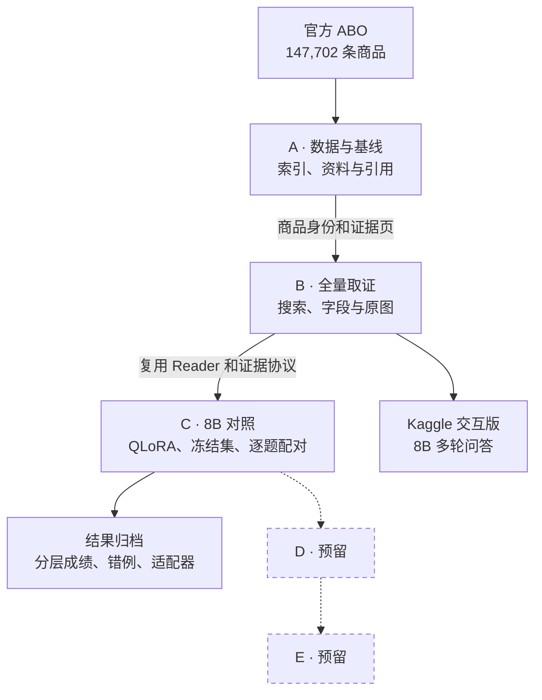

# 电商商品知识多模态 RAG

面向商品资料查阅、规格表和商品图片问答的个人 AI 应用项目。先完成 RAG，后续再接电商 Agent。

## A→B→C 项目总图



[查看 A、B、C 三张阶段流程图与代码对应](personal/ecommerce_rag/docs/A-C架构与流程.md) · [8B 分层与配对报告](personal/ecommerce_rag/docs/kaggle-8b/报告.md)

A 提供可追溯的商品库和证据格式。B 从全量库找商品并按问题选择结构化字段、原图或组合证据。C 固定输入证据，分别衡量原提示、改进提示和同提示加 LoRA 的表现。D、E 在总图预留，后续实现后再接入。

| 已完成的验收 | 实际结果 |
| --- | --- |
| 全量搜索 | 147,702 条商品记录，576 类，32 站点 |
| 120 道检索查询准确商品 Hit@5 | BM25 114/120，Dense 58/120，RRF 94/120 |
| Kaggle B 阶段 | 10 轮，覆盖普通对话、搜索、选择、来源字段、原图、政策快照和业务边界 |
| C 初版 60/25 三组严格通过 | 问答 195/210、196/210、199/210；照片 70/100、70/100、74/100 |
| C 当前 120/50 适配器严格通过 | 原问答 201/210、原 5 类照片 75/100、新 15 类照片 47/75 |

576 类是全库查询范围。210 道问答的主商品覆盖 35 类，照片为 20 类抽样。Kaggle 日常演示使用 8B 底座和全量 BM25，C 阶段根据原题及跨类目增补题的配对结果选定适配器。[覆盖范围、抽样依据与选版结果](personal/ecommerce_rag/docs/kaggle-8b/覆盖与选版.md)

## 运行与记录

交互、读图和 QLoRA 统一使用 Qwen3-VL-8B-Instruct。A/B 的 SQLite 检索可在 CPU 上运行，8B 生成和 C 阶段微调在 Kaggle 的 CUDA GPU 上运行。B 的稠密检索和可选重排继续使用各自的检索模型。[8B 启动与复现](personal/ecommerce_rag/docs/kaggle-8b/launch/README.md)

在已配置数据和环境的本地工作区根目录运行：

```powershell
.\scripts\run_stage_a.ps1 -Command check
.\scripts\run_stage_b.ps1 -Command search -Question "black backpack"
.\scripts\run_stage_c.ps1 -Command cloud-status
```

商品对话支持搜索、选中候选、连续追问和来源引用。普通对话也使用同一 8B，普通历史与商品证据分别维护。HTTP 客户端使用返回的 `session_id` 延续会话。

本地运行目录保存配置、逐题 TXT 和 JSONL。早期小样本基线及旧模型成绩作为历史实验单独归档。公开仓库提供项目源码、启动文件和评测摘要。[代码阅读地图](personal/ecommerce_rag/docs/代码阅读地图.md)

## 来源

上游起点 `OpenBMB/VisRAG@7205787862e35d70cee7ebfd8f2b58d3eb5d563b`。[原作者README](README.upstream.md)、[LICENSE](LICENSE)和原视觉算法代码保留。A的BM25链路是个人应用模块，不宣称复现原论文视觉检索指标。

本项目参考按问题分流、证据不足时有限补检的思路。项目自己的实现包括全量商品身份与来源绑定、字段和原图分流、家族隔离的多模态评测以及 8B 适配器对照。[Adaptive-rag](https://github.com/JEen-wang/Adaptive-rag)

ABO源数据/图片归Amazon.com，数据集作者署名和CC BY 4.0原文随本地数据保存。来源：[官方数据页](https://amazon-berkeley-objects.s3.us-east-1.amazonaws.com/index.html)。基础模型与上游成果归各原作者；本项目业务路由、资料转换、分块/引用实验、评测和记录按实际实现说明。

仓库默认分支为 `feat/ecommerce-rag`，`master` 保留上游基线。
