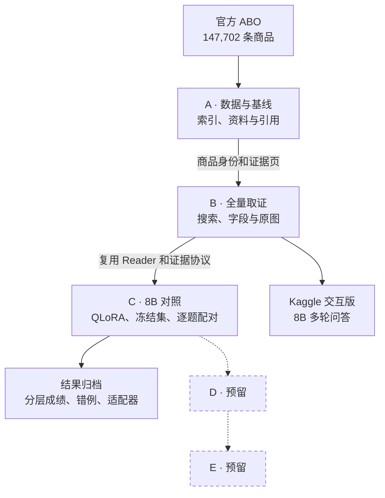

# 电商商品知识多模态 RAG

面向商品资料查阅、规格表和商品图片问答的个人 AI 应用项目。先完成 RAG，后续再接电商 Agent。

## A→B→C 项目总图



[查看 A、B、C 三张阶段流程图与代码对应](personal/ecommerce_rag/docs/A-C架构与流程.md) · [8B 分层与配对报告](personal/ecommerce_rag/docs/kaggle-8b/报告.md)

A 提供可追溯的商品库和证据格式。B 从全量库找商品并按问题选择结构化字段、原图或组合证据。C 固定输入证据，分别衡量原提示、改进提示和同提示加 LoRA 的表现。D、E 在总图预留，后续实现后再接入。

| 已完成的验收 | 实际结果 |
| --- | --- |
| 全量搜索 | 147,702 条商品记录，576 类，32 站点 |
| 120 道检索查询准确商品 Hit@5 | BM25 114/120，Dense 58/120，RRF 94/120 |
| Kaggle B 阶段 | 10 轮，覆盖普通对话、搜索、选择、来源字段、原图、政策快照和业务边界 |
| C 初版 60/25 三组严格通过 | 问答 195/210、196/210、199/210；照片 70/100、70/100、74/100 |
| C 当前 120/50 适配器严格通过 | 原问答 201/210、原 5 类照片 75/100、新 15 类照片 47/75 |

576 类是全库查询范围。210 道问答的主商品覆盖 35 类，照片为 20 类抽样。Kaggle 日常演示使用 8B 底座和全量 BM25，C 阶段根据原题及跨类目增补题的配对结果选定适配器。[覆盖范围、抽样依据与选版结果](personal/ecommerce_rag/docs/kaggle-8b/覆盖与选版.md)

## 历史 A 阶段真实数据基线

- 官方 Amazon Berkeley Objects（ABO）元数据/原图，24 个椅子商品，转换为48页来源可追溯PDF资料卡。转换PDF、152道题和开发/测试划分为本项目自建，不是官方问答基准或厂家原始手册。
- 原生文字块/坐标 + 必要时 RapidOCR → BM25文字块检索 → 父页面去重 → 本地 Qwen3.5-2B 看页面图片 → 引用/拒答/逐题记录。
- 商品编号、站点、快照日期范围规则路由；澄清、资料不足、需要实时工具、场外分支。当前没有执行订单、价格、库存或退款工具。
- 两个单因素改进：整页→文字块（修复跨商品证据漏召回，也暴露引用退化）；再单独澄清引用标签与物理页码。全部收益与退化保留。
- 冻结的12个独立商品测试组共76题：56道可回答题中55道满足答案及引用要求；12道未知题、8道业务边界题动作正确；零运行异常。一次裸No未满足JSON/引用协议，系统拒答，未追分修补。
- 39项单元/回归检查通过；本地HTTP健康检查、输入校验、真实图片问答与2槽并发保护通过。

这些是小型、自建、含字段提示的资料卡任务；单商品2页而Top-2全覆盖，高召回有任务设计因素。不能作为普遍真实客服准确率、线上A/B收益或生产上线证明。原始属性也有质量问题，出处可靠不代表每字段正确。

## 运行与证据

日常 8B 演示使用 Kaggle 交互 Notebook。运行环境、模型挂载及本地工作区布局见 [8B 启动说明](personal/ecommerce_rag/docs/kaggle-8b/launch/README.md)。以下 PowerShell 命令在配置好的本地工作区根目录运行。

```powershell
.\scripts\run_stage_a.ps1 -Command check
.\scripts\run_stage_b.ps1 -Command search -Question "black backpack"
.\scripts\run_stage_c.ps1 -Command cloud-status
```

- [A阶段面试覆盖与代码对应](personal/ecommerce_rag/docs/A阶段实施与面试覆盖.txt)
- [A阶段用法](personal/ecommerce_rag/README.md)
- 本地连续操作和问题日志位于 `personal/a_baseline/docs/`。
- 本地真实测试逐题TXT：`reports/ecommerce_rag/abo-a-test-final-v1/逐题结果.txt`；总表：`记录/逐题结果汇总.txt`。
- 本地验收：`记录/A阶段完成情况与验收报告.txt`；数据来源与署名：`data/ecommerce_rag/abo-cards-v1/ATTRIBUTION.txt`。
- 运行保留JSONL、原始输出、图片、配置/代码SHA、输入清单与代码快照；gold不进入正常Reader，oracle仅开发诊断。

## 终端连续聊天

已补终端自然语言输入循环、问候、商品上下文、异常恢复和逐轮记录；同一进程复用模型。Windows PowerShell5.1下验证宽度25 inches后继续追问重量33 pounds，两次只加载一次模型。HTTP接口共用会话处理，使用返回的session_id继续。

详见[连续聊天说明](personal/ecommerce_rag/docs/终端连续聊天.txt)。这是商品上下文管理，没有实现自主Agent或长期用户记忆。

## 历史方案与回归

历史 A 完成后提出 B 检索对照和 C 定向 LoRA，当前实现见上方 A→B→C 项目总图。

旧的4份PDF/16题虚构路由器样例保留作功能回归，不能与真实ABO测试混报。原模拟应用的BM25+BGE/RRF和独立VisRAG视觉工具仍保留，不表示真实商品视觉融合已完成。

## 来源

上游起点 `OpenBMB/VisRAG@7205787862e35d70cee7ebfd8f2b58d3eb5d563b`。[原作者README](README.upstream.md)、[LICENSE](LICENSE)和原视觉算法代码保留。A的BM25链路是个人应用模块，不宣称复现原论文视觉检索指标。

本项目参考按问题分流、证据不足时有限补检的思路。项目自己的实现包括全量商品身份与来源绑定、字段和原图分流、家族隔离的多模态评测以及 8B 适配器对照。[Adaptive-rag](https://github.com/JEen-wang/Adaptive-rag)

ABO源数据/图片归Amazon.com，数据集作者署名和CC BY 4.0原文随本地数据保存。来源：[官方数据页](https://amazon-berkeley-objects.s3.us-east-1.amazonaws.com/index.html)。基础模型与上游成果归各原作者；本项目业务路由、资料转换、分块/引用实验、评测和记录按实际实现说明。

当前开发分支 `feat/ecommerce-rag`；默认master仍保留上游基线。
