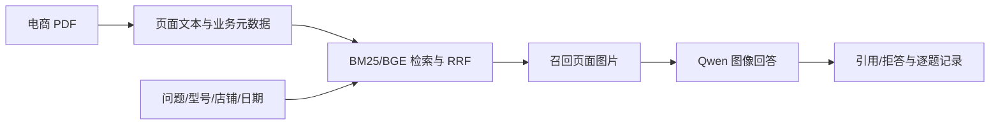

# 电商商品知识与售后服务多模态 RAG

面向商品参数、接口图、使用手册、排障与售后知识的个人应用项目。当前以虚构的家用路由器资料验证流程，先做 RAG，后续再做电商 Agent。

本分支 `feat/ecommerce-rag` 已清理旧论文业务、通用示例数据和旧实验。保留电商数据/运行证据、公共多模态能力、模型和环境，以及上游来源。默认 `master` 仍为上游基线。

## 当前能力

- BM25＋BGE 中文文本检索与 RRF；型号、店铺、版本有效期过滤。
- 召回页面渲染为图片，本地 Qwen3.5-2B 回答并引用 PDF 页码。
- 缺型号澄清、未知资料拒答、实时订单/价格等返回未接工具状态。
- 逐题 JSONL/TXT、原始输出、图片、耗时、模型/配置/代码版本。
- 独立 VisRAG-Ret 页面视觉编码与受业务过滤的检索工具，入口已使用电商资料。当前应用仍使用文字混合检索；完整视觉 RAG、文字—视觉融合和训练对照尚未完成。

## 代码入口

- [电商应用与运行命令](personal/ecommerce_rag/README.md)
- [电商代码阅读地图](personal/ecommerce_rag/docs/代码阅读地图.md)
- [公共 PDF/OCR、VLM 和记录模块](personal/rag_common/README.md)
- [页面视觉编码工具](personal/visrag_repro/README.md)
- [操作方法与结果](personal/a_baseline/docs/操作方法与结果记录.txt)
- [问题与解决记录](personal/a_baseline/docs/问题与解决记录.txt)



## 数据与评测边界

当前为明确标注模拟的 4 份 PDF、8 页、16 道开发题。当前资料、问题和索引保存在工作区 `data/ecommerce_rag/demo-v1/`，运行在 `reports/ecommerce_rag/<run-name>/`。既有电商失败和修正记录保留，原始 JSONL/配置/快照不改写。

BM25-v1 与混合-v1 在小样例上的指标相同，没有观察到混合检索收益；v3 的动作协议改进来自输出保护。不能将模拟功能结果视为真实业务准确率。真实商品独立开发/测试、重排、有限重试、LoRA、业务 Agent 仍待完成。

## 本机运行

工作区 `E:\大模型项目自学E\doc-vqa-assistant`；模型、数据、环境和缓存均在 E 盘。新机器仍需单独准备模型/数据。依赖锁在电商与视觉工具目录。

```powershell
.\.venv\Scripts\python.exe .\upstream\VisRAG\personal\ecommerce_rag\ask.py "DN-R100 的 WAN 口是什么颜色？" --sku DN-R100 --run-name my-question-01
.\.venv\Scripts\python.exe .\upstream\VisRAG\personal\ecommerce_rag\run.py run --mode hybrid --run-name my-smoke-01
.\scripts\run_visual_index.ps1 -IndexName my-visual-pages -RetrievalName my-visual-queries
```

## 来源与结构

上游起点 `OpenBMB/VisRAG@7205787862e35d70cee7ebfd8f2b58d3eb5d563b`。[原作者 README](README.upstream.md)、[LICENSE](LICENSE)、原论文引用及视觉算法源码保留。

`personal/ecommerce_rag/` 是电商应用；`personal/rag_common/` 是公共运行能力；`personal/visrag_repro/` 是保留原编码器的视觉工具。`personal/a_baseline/` 现在只保留用户约定的连续日志。

基础模型、上游架构与原论文成果归原作者；本项目的应用实现、业务约束和实验应按实际完成情况说明。
