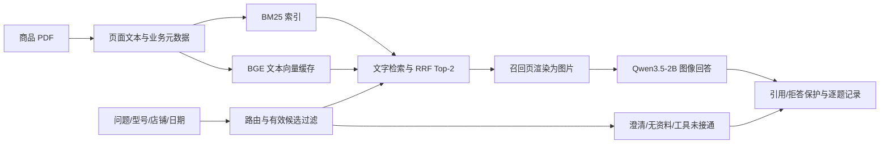

# 电商商品知识与售后服务多模态 RAG

围绕商品手册、参数表、接口图和售后知识，回答“这款商品有什么参数”“图中哪个接口怎么接”“两个型号有何区别”，并给出 PDF 证据页。

这是基于 VisRAG 仓库开展的个人学习与应用开发项目。当前电商实现位于 `personal/ecommerce_rag/`；原版检索复现与历史实验分别保留。开发分支为 `feat/ecommerce-rag`，默认 `master` 目前仍是上游基线。

**当前阶段：模拟电商数据上的 RAG 功能原型。** 真实商品独立评测、电商视觉向量融合、微调及业务 Agent 尚未完成。当前没有订单、库存或交易服务。

## 先看什么

- [电商代码阅读地图](personal/ecommerce_rag/docs/代码阅读地图.md)：从 PDF、编码、Top-k 到页面图像问答和保存结果。
- [运行说明与已知限制](personal/ecommerce_rag/README.md)：已有功能、命令及数据边界。
- [阶段实施方案](personal/ecommerce_rag/docs/方向与阶段验收.txt)：后续 RAG 增强与 Agent 的边界。
- [16 题原始结果 TXT](personal/ecommerce_rag/evidence/ecom-hybrid-smoke-v3/逐题结果.txt)、[JSONL](personal/ecommerce_rag/evidence/ecom-hybrid-smoke-v3/results.jsonl)、[配置](personal/ecommerce_rag/evidence/ecom-hybrid-smoke-v3/config.json)。
- [操作方法与结果](personal/a_baseline/docs/操作方法与结果记录.txt)、[问题与解决记录](personal/a_baseline/docs/问题与解决记录.txt)。

## 已实现的电商功能

1. PDF 页面文本提取与商品型号、店铺、版本、资料有效期绑定。
2. BM25 与 BGE-small-zh-v1.5 中文文本向量检索，使用 RRF 融合排名；页面文本向量提前在 CPU 编码并保存。
3. 候选融合前限制商品型号、店铺和有效期；比较两个型号时保留双方候选。
4. 根据召回页码渲染 PDF 页面图片，本地 Qwen3.5-2B 读图作答，返回页面引用。
5. 型号缺失或冲突时澄清；未知型号或缺少信息时拒答；订单/物流/实时价格/库存只返回 `requires_tool`，明确服务未接入。
6. 保存原始模型输出、引用、检索排序、耗时、模型 revision、配置、代码快照，以及逐题 JSONL/TXT。

当前 BGE 编码的是**文字**，VLM 阅读的是**图片**。这属于多模态问答应用，但电商链路尚未使用 VisRAG-Ret 页面图像向量，也没有完成文字—视觉融合实验。

## 当前链路



## 数据与实际结果

当前是自行编写并明确标注虚构的 DemoMall 功能资料：4 份 PDF、8 页、16 道 `smoke_dev` 问题，含两个路由器型号、一个型号的新旧手册及模拟政策。它们不是实际商家商品或真实售后承诺，没有独立电商测试集。

| 运行 | 有证据题 Top-2 命中 | 全部 16 题动作正确 | 严格文本匹配 |
|---|---:|---:|---:|
| BM25 v1 | 11/11 | 15/16 | 14/16 |
| BM25+BGE v1 | 11/11 | 15/16 | 14/16 |
| BM25+BGE v3，补充输出保护 | 11/11 | 16/16 | 15/16 |

第一、二行使用同一提示，没有观察到混合检索收益；第三行的动作提升来自显式拒答保护，不能归因于检索增强。文本评分把“2个”和“2 个”判为不匹配，已保存这一已知低估，旧标签和分数不变。

动作正确、引用页重合不等于语义正确或真实业务泛化。JSON/引用范围与词句保护也不等于通用幻觉检测器。全部原始输出和失败历史保留。

另有 27 页、10 题的 [VisRAG-Ret 原版核心推理复现](personal/visrag_repro/README.md)，以及历史 ViDoSeek 100 题（开发/最终测试各 50）的通用评测。这些不能替代电商独立评测；最终 50 题尚未运行。

## 本机运行

现有工作区为 `E:\大模型项目自学E\doc-vqa-assistant`，在该目录的 PowerShell 中执行。每次使用新的运行名，保留旧结果。

```powershell
# 任意问题，不提供参考答案
.\.venv\Scripts\python.exe .\upstream\VisRAG\personal\ecommerce_rag\ask.py "DN-R100 的 WAN 口是什么颜色？" --sku DN-R100 --run-name my-question-01

# 当前模拟 16 题完整运行
.\.venv\Scripts\python.exe .\upstream\VisRAG\personal\ecommerce_rag\run.py run --mode hybrid --run-name my-smoke-01

# 不加载模型的业务边界检查
.\.venv\Scripts\python.exe .\upstream\VisRAG\personal\ecommerce_rag\test_retrieval.py
```

本机 `.venv` 为 Qwen 环境，`.venv-visrag` 为原版 VisRAG-Ret 核心推理环境。依赖锁分别见 [电商推理依赖](personal/ecommerce_rag/requirements.local.lock.txt) 与 [原版检索依赖](personal/visrag_repro/requirements.freeze.txt)。模型、PDF、向量缓存、全部输入图片及运行快照保留在 E 盘工作区，不全包含在 Git 仓库中。

新机器需要单独准备模型和数据；工作区路径可通过 `DOC_VQA_WORKSPACE` 指定。不能将仅克隆本仓库表述为已经备齐所有运行资产。

## 上游与本分支新增内容

| 来源 | 内容与归属 |
|---|---|
| OpenBMB/VisRAG | 原始仓库、视觉检索方法、demo 与训练/评测实现；原论文成果属于原作者 |
| Qwen、BGE、VisRAG-Ret 的发布者 | 预训练模型和权重；本项目调用模型，没有从零训练这些基础模型 |
| `personal/ecommerce_rag/` | 本分支新增电商数据约定、业务过滤、中文文字检索融合、页面图像问答、行为与输出保护、任意问题入口和运行记录 |
| `personal/a_baseline/` | 本分支新增文本/OCR 基线、数据核验、记录/评测与历史对照 |
| `personal/visrag_repro/` | 原版核心推理的独立环境、向量缓存、兼容处理与相同题对照 |

上游起点：`7205787862e35d70cee7ebfd8f2b58d3eb5d563b`。原文保存在 [README.upstream.md](README.upstream.md)，[LICENSE](LICENSE) 保持不变，上游论文引用及原作者说明完整保留。

本项目可以表述为“复用开源模型与检索方法构建电商多模态 RAG，并实现业务约束、评测和实验对照”。模型架构、上游论文方法与原论文成绩不属于本分支的原创贡献。

## 后续工作

- 收集同一商品类目的真实手册/图示/FAQ，保存来源、型号、版本和有效期，建立独立电商开发/最终测试集合。
- 固定生成器，对比 BM25、文本稠密、页面视觉和融合；根据失败再增加重排及最多一次改写检索。
- 正确证据诊断后，再确定是否及如何做 LoRA；不能用提示变化代替训练收益。
- 后续电商 Agent 复用稳定 RAG，再接业务工具与多轮状态。当前不实施多 Agent、真实订单或交易操作。
