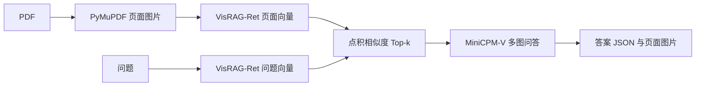

# 先追踪一次问题如何得到答案

上游基准：`OpenBMB/VisRAG@7205787862e35d70cee7ebfd8f2b58d3eb5d563b`。
官方源代码、Apache-2.0 许可证、论文引用说明都保留。个人改动集中在 `personal/a_baseline/`。

## 上游原始链路

| 你要找的步骤 | 上游代码位置 | 应读的函数/语句 | 输入与产出 |
|---|---|---|---|
| PDF → 图片 → 向量 | [build_index.py](../../../visrag_scripts/demo/visrag_pipeline/build_index.py) | `add_pdfs`、`fitz.open`、`page.get_pixmap(dpi=200)` | PDF 页面转 PIL 图片；逐页编码 |
| 保存检索库 | 同上 | `np.save`、`index2img_filename.txt` | `reps.npy` 与向量行号到图片名的映射 |
| 图像/问题如何编码 | [utils.py](../../../visrag_scripts/demo/visrag_pipeline/utils.py) | `encode`、`weighted_mean_pooling`、`F.normalize` | 隐状态加权池化，L2 归一化，输出 NumPy 向量 |
| Top-k 检索 | [answer.py](../../../visrag_scripts/demo/visrag_pipeline/answer.py) | `retrieve` | 给问题加 instruction；`torch.matmul(query_rep, doc_reps.T)`；`torch.topk` |
| 页面如何交给 VLM | 同上 | `answer_question` | `content=[question, *images]`，`gen_model.chat` |
| 保存问答 | 同上底部交互循环 | `json.dumps`、`image.save` | 保存 query、retrieved_images、answer 与页面图片 |
| 批量生成与计分 | [generate.py](../../../visrag_scripts/generate/generate.py) | `main`、`check_responses`、`write_results`、`write_history` | 读取已有检索结果并批量问答/计分 |
| 新增 EVisRAG 评测入口 | [eval.py](../../../src/evisrag/eval.py) | `normalize_answer_qa`、`evaluate_predictions`、`run_evaluation` | 阅读归一化与指标定义，勿混同不同评测协议 |

注意：上游 demo 图片名中的页下标从 **0** 开始。个人结果统一使用 **1 起始的物理 PDF 页码**，例如 `attention:p0003` 表示 PDF 第 3 页。论文印刷页号可能不同。

## 本次真正运行的 A 版本

为了在本机 8GB 显存建立基线，A 使用 **PDF 原生文本/必要时 OCR → BM25 召回页面 → 页面图像 → Qwen3.5-2B**。
这是在 Fork 内增加的文本检索基线与评测模块；尚未运行上游 VisRAG-Ret 视觉检索，不能在简历上写成“已复现原版视觉检索”。

| 步骤 | 个人代码 | 你的第一轮阅读任务 |
|---|---|---|
| 建页面语料 | [core.py](../core.py) `build_pages` | 找到 PDF 校验、原生文本、OCR 回退、页 ID |
| 检索 | 同上 `tokenize`、`TextRetriever.search` | 理解 BM25 的词匹配、排序分数与参数 |
| 页面渲染 | 同上 `render_page` | 理解像素上限如何影响字的清晰度、视觉 token 和显存 |
| VLM 输入 | 同上 `build_messages`、`VLMReader.read` | 确认参考答案/参考页号没有进入模型输入 |
| 输出解析 | 同上 `parse_answer` | 原始输出总是保存；非法 JSON 不被偷偷修好 |
| 统一记录 | [run.py](../run.py) `run` | 每道题立即写 JSONL，运行配置、源代码快照与哈希一起保存 |
| 检索/答案指标 | [core.py](../core.py)、[run.py](../run.py) `summarize` | 分开看“没找对页”“有证据但答错”“输出格式失败” |

第一轮先把 `smoke-05` 的输入、召回页、原始答案和参考证据对照起来；它是实际失败样本，适合解释为什么需要后续 B 阶段。
