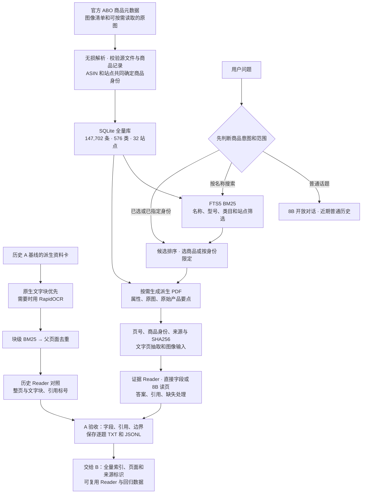
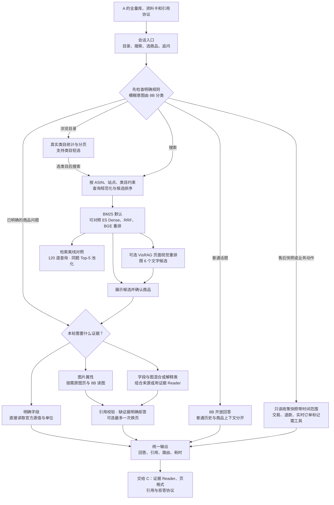
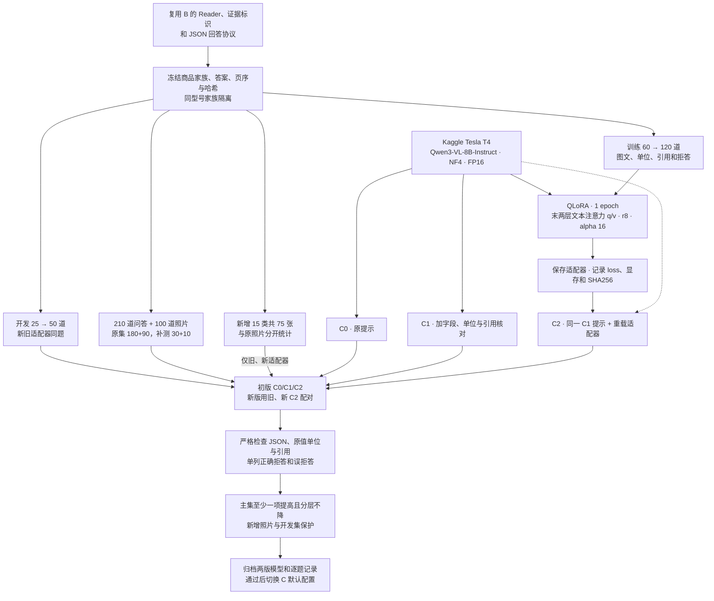

# A–C 项目架构与流程

本项目把商品资料问答拆为三个可独立验收的阶段。A 统一商品身份、索引和证据格式，B 负责多轮交互时的检索与证据选择，C 用固定证据检验回答、引用和拒答。三阶段共享来源标识与逐题记录。D、E 的接口和实现留待后续阶段。

## A · 商品数据、证据和检索基线

| 模块 | 对应实现 |
| --- | --- |
| 全量导入、商品家族、站点身份和索引 | [full_catalog.py](../full_catalog.py)、[full_catalogue.py](../full_catalogue.py) |
| 官方图像缓存、资料卡和来源信息 | [full_cards.py](../full_cards.py) |
| 历史 A 分块、OCR、父页检索与 Reader | [stage_a_index.py](../stage_a_index.py)、[stage_a.py](../stage_a.py) |
| 统一交互、路由和逐题记录 | [full_app.py](../full_app.py)、[full_conversation.py](../full_conversation.py)、[full_audit.py](../full_audit.py) |

原 24 商品/152 题属于历史 A 基线。全量检索覆盖 147,702 条元数据，原图与派生页按使用需要生成。照片能提供哪些证据取决于源图实际展示的内容。

## B · 全量检索、对话和自适应取证

| 模块 | 对应实现 |
| --- | --- |
| 商品对象、站点过滤、最近任务和普通聊天 | [full_app.py](../full_app.py)、[full_conversation.py](../full_conversation.py) |
| 文本 BM25、多语言 E5、RRF 与独立重排 | [full_retrieval.py](../full_retrieval.py)、[full_dense.py](../full_dense.py)、[full_encoder.py](../full_encoder.py) |
| 候选内视觉重排 | [full_visual.py](../full_visual.py) |
| 结构化字段、原图页、换页预算和政策快照 | [full_evidence.py](../full_evidence.py)、[full_policy.py](../full_policy.py) |
| 全库检索对照与新题池化 | [full_evaluate.py](../full_evaluate.py)、[c8_retrieval_eval.py](../c8_retrieval_eval.py) |

全库 BM25 是当前默认。Dense、RRF 和重排属于可选实验路径。Kaggle 交互验收用全量 SQLite BM25。Kaggle 固定证据评测与日常应用的在线取证分别计分。

## C · 8B 微调和同题配对评测

| 模块 | 对应实现 |
| --- | --- |
| 训练/开发/测试家族隔离与派生表格 | [c8_protocol.py](../c8_protocol.py) |
| 原图照片、人工标注与新增 40 题 | [c8_photos.py](../c8_photos.py)、[c8_supplement.py](../c8_supplement.py) |
| 8B 4-bit 加载、QLoRA、相同输入三组预测 | [qwen8_runtime.py](../qwen8_runtime.py)、[c8_experiment.py](../c8_experiment.py) |
| 评分器和逐题配对退化记录 | [stage_c.py](../stage_c.py)、[合并验收](kaggle-8b/合并验收.txt) |
| 120/50 训练和 20 类选版 | [c8_upgrade.py](../c8_upgrade.py)、[c8_visual_breadth.py](../c8_visual_breadth.py)、[选版报告](kaggle-8b/覆盖与选版.md) |

210 道问答包含 60 道单字段、50 道双商品、40 道单位/表格/图表、30 道引用证据和 30 道缺失拒答。原 5 类各 20 张，另有 15 类各 5 张，合计 20 类 175 张。原照片集含一张真图的受控失焦版本。固定证据用于观察 Reader 的变化，日常检索质量由 B 的全库对照衡量。
