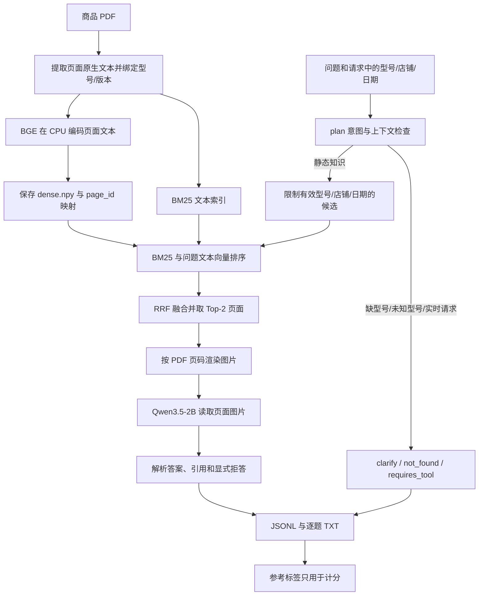

# 电商 RAG：先追踪一个问题

当前数据是明确标注的模拟商品资料。先用 `ecom-03`“DN-R100 的 WAN 接口是什么颜色？”对照实际输入图、候选、答案与引用；再看 `ecom-11` 缺少信息时的拒答和 `ecom-12` 订单请求的工具未接通状态。

## 当前真正运行的链路

这里的缓存向量是 **BGE 页面文本向量**。页面图片目前交给 VLM 回答；电商链路还没有 VisRAG-Ret 页面图像向量、纯视觉检索或文本—视觉融合。历史原版视觉复现见 [VisRAG-Ret 模块](../../visrag_repro/README.md)。

## 每一步对应哪里

| 想搞清楚的步骤 | 代码入口 | 重点检查 |
|---|---|---|
| 演示 PDF、问题和参考证据从哪里来 | [prepare_demo.py](../prepare_demo.py) | 虚构商品与政策的标识；不是抓取的真实商家资料 |
| PDF 如何成为页面文本 | [core.py](../../a_baseline/core.py) 的 `build_pages` | 原生文本、页 ID、PDF 路径；当前电商索引 `ocr_fallback=False` |
| 型号、店铺与有效期如何绑定 | [retrieval.py](../retrieval.py) 的 `make_index` | `documents.json` 元数据绑定到 `pages.jsonl`，保留物理页码 |
| 页面和问题怎样编码 | 同上 `DenseEncoder.encode` | 输入是文字；CLS 池化、L2 归一化、512 维；问题附检索 instruction |
| 向量和页码保存在哪里 | 同上 `make_index` | `data/ecommerce_rag/demo-v1/dense.npy` 行号对应 `pages.jsonl`；manifest 保存哈希 |
| 哪些请求不进入模型 | 同上 `plan` | 缺型号澄清、未知型号拒答、订单/价格等返回未接工具状态；当前是规则路由 |
| 如何限制候选与找到 Top-k | 同上 `active`、`eligible`、`Retriever.search`、`rrf` | 候选在融合前按型号/店铺/日期限制；BM25 与 BGE 排名融合；多型号覆盖 |
| PDF 页面如何变成图片 | [core.py](../../a_baseline/core.py) 的 `render_page` | 物理页码从 1 开始；每页像素预算；按召回记录读取正确 PDF |
| 图片如何交给 VLM | [run.py](../run.py) 的 `EcommerceReader.read` | 每页图像与 P1/P2 标签；问题和业务上下文；参考答案不进入提示 |
| 如何处理答案与引用 | 同上 `decode_business_output`；`core.py` 的 `parse_answer` | P1/P2 映射到真实 page_id；原始输出保留；输出保护不等于语义忠实度判别 |
| 如何保存和计算指标 | `run.py` 的 `run`；[audit.py](../../a_baseline/audit.py) | JSONL 先落盘，再写 TXT；保存配置/代码快照；区分检索、动作与文本匹配 |
| 如何输入任意问题 | [ask.py](../ask.py) | 不需要参考答案；未标注交互题不计算准确率 |

## 先打开三个实际例子

从工作区 `E:\大模型项目自学E\doc-vqa-assistant` 查看：

1. `reports/ecommerce_rag/ecom-hybrid-smoke-v3/逐题结果.txt` 的 `ecom-03`：检查“蓝色”是否由接口图支持，引用是否对应实际图片。
2. 同文件 `ecom-11`：模型原始回答为“未报告”，程序归一化为 `not_found`；这次改进属于输出协议，不属于检索收益。
3. 同文件 `ecom-12`：订单查询返回 `requires_tool`，`model=None`、生成耗时为 0；没有假装调用真实订单服务。

所有 16 题都是 `smoke_dev`。它们可用于走读与功能回归，不能当作独立电商测试成绩。

## 当前代码来源与个人模块

上游起点：`OpenBMB/VisRAG@7205787862e35d70cee7ebfd8f2b58d3eb5d563b`。上游模型、原论文与原始检索方法分别保留原作者归属。

新增应用/实验模块：`personal/ecommerce_rag/`、`personal/a_baseline/`、`personal/visrag_repro/`。应结合 Git 差异解释新增业务过滤、融合、记录、评测和兼容处理，不能把上游 VLM、检索模型或论文方法说成自己从零提出。
